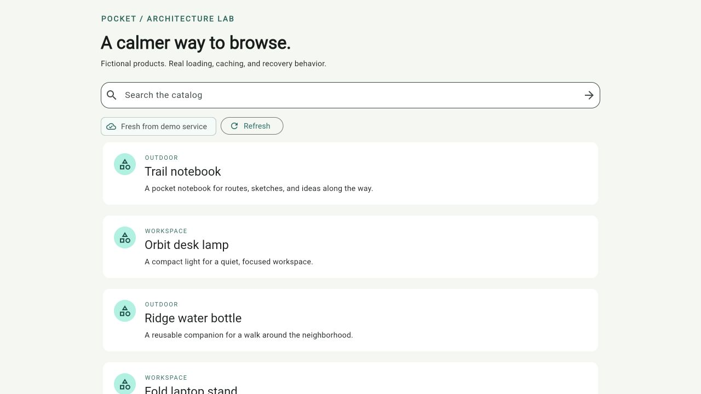
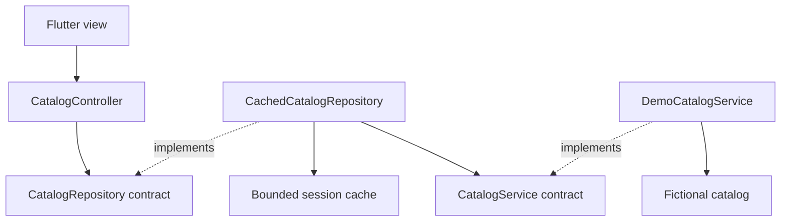

# Pocket Catalog

### A Flutter architecture lab for dependable mobile experiences

**[Try the live demo →](https://ramysaleeb.github.io/flutter-mobile-architecture-lab/)** · Runs in your browser; no installation or sign-in required.

An original, runnable demo by [Ramy Saleeb](https://github.com/RamySaleeb), built around one question: **what should the user see when a request is slow, fails, or finishes out of order?**

Pocket Catalog browses fictional products through a simulated service. It keeps useful content visible during refresh, reuses fresh cached results, and prevents older requests from replacing a newer search. No API keys, backend deployment, or private source code required.

**Flutter · Dart · Repository pattern · Immutable state · Stale-while-revalidate · Behavioral tests**



## Start here

For a quick look, [open Pocket Catalog in your browser](https://ramysaleeb.github.io/flutter-mobile-architecture-lab/). Search the fictional catalog, trigger a failed refresh, and try the offline simulation. The cache lasts for the current app session; reloading resets it. Initial loading requires an internet connection.

To explore the source locally:

```bash
git clone https://github.com/RamySaleeb/flutter-mobile-architecture-lab.git
cd flutter-mobile-architecture-lab
flutter pub get
flutter test
# Generate standard platform hosts; the architecture source stays in lib/.
flutter create --platforms=android,ios,web --project-name=pocket_catalog --no-pub .
flutter run -d chrome
```

Tested with **Flutter 3.47.7 / Dart 3.13.5**. Use `flutter devices` and `flutter run -d <device-id>` for an Android emulator or iOS simulator. Native runs require the usual Android SDK or Xcode setup; they have not been device-tested for this initial release. Platform scaffolding is generated, not maintained in this repository. There are no third-party runtime packages.

## A two-minute walkthrough

[Open the live demo](https://ramysaleeb.github.io/flutter-mobile-architecture-lab/) and start with a fresh page. Scroll below the results to find the simulation controls. Submit searches with Enter or the arrow button; typing alone does not start a request.

| Step | Try this | What you should see | What it demonstrates |
| --- | --- | --- | --- |
| 1. Browse | Wait for the initial load. | Six fictional products and **Fresh from demo service**. | Loading becomes useful content. |
| 2. Search and reuse | Submit `outdoor`, then submit it again within 30 seconds. | Trail notebook and Ridge water bottle; the second submission shows **Session cache**. | A fresh query cache avoids another service call. |
| 3. Fail safely | With those results loaded, click **Fail next refresh**. | An error with **Retry**, while both products remain visible. | A failed refresh preserves the last good snapshot. This button starts the refresh itself. |
| 4. Recover | Click **Retry** with simulation offline switched off. | The error clears and **Fresh from demo service** returns. | Recovery does not require reloading the page. |
| 5. Try an uncached failure | Switch on **Simulate offline**, then submit `workspace` for the first time. | A recoverable load error, without the unrelated outdoor results. | Cache entries belong to a specific query. |
| 6. Recover and explore empty results | Switch simulation off and click **Retry**; then submit `zzzz`. | Two workspace products, then an empty-results state for `zzzz`. | Empty results and failures are different states. |

**One more experiment:** reload `outdoor`, wait at least 30 seconds, and submit it again. Cached content appears immediately while it revalidates. **Refresh** always requests new data, even if the cache is fresh.

The controls simulate service behavior; they do not inspect or alter device connectivity. Availability is sampled when a request starts, and ordinary simulated requests take 750 ms (the race scenario below uses two different delays). Reloading the page resets the session cache and controls; the initial page load requires internet access.

### Watch the latest search win

Near the search field, choose **Run request race**. No fast typing is needed:

1. A fresh demo session starts an **Outdoor** request with a 3-second delay, then a **Workspace** request with a 0.75-second delay.
2. Workspace finishes first. Orbit desk lamp and Fold laptop stand appear while Outdoor is still pending.
3. Outdoor finishes last. The screen keeps Workspace results; the older response only warms its own query cache.

Choose **Run with older failure** to repeat the sequence with the older request failing. Workspace remains visible, and the obsolete error does not replace the current screen. The status text explains each stage.

Both scenarios force new requests in an isolated session, so repeats work even after those queries were cached. Search and failure controls pause during a race; **Reset demo** is always available and restores normal browsing, an empty cache, and default simulation settings. Late completions from a reset session cannot update the screen. After a completed race, ordinary requests use the normal 750 ms delay again.

These are deterministic simulated delays, not a network benchmark. Request deduplication and completion ordering are also covered by controlled tests.

## Architecture



| Boundary | Responsibility | Read the code |
| --- | --- | --- |
| Model and contracts | Immutable snapshots; query normalization; transport/repository interfaces | [catalog.dart](lib/catalog.dart) |
| Data | Query-keyed cache, TTL, LRU eviction, in-flight request sharing | [catalog_data.dart](lib/catalog_data.dart) |
| Presentation | Cache-first display, refresh policy, error state, latest-request protection | [catalog_controller.dart](lib/catalog_controller.dart) |
| UI and composition | Material UI, lifecycle, explicit dependency construction, demo controls | [main.dart](lib/main.dart) |
| Verification | Deterministic service fakes and a widget journey | [widget_test.dart](test/widget_test.dart) |

The model and data layer do not import Flutter. The controller depends only on Flutter's lightweight notifier and a repository interface. The view constructs dependencies at its composition boundary; individual product widgets do not access services.

## Behavior under pressure

| Situation | Result |
| --- | --- |
| First load, no cache | Loading state, then content, empty results, or a retryable error |
| Same query, fresh cache | Immediate cached content; no service call |
| Same query, expired cache | Immediate cached content while revalidation runs |
| Manual refresh | Service call even if the cache is fresh |
| Failed refresh | Last good snapshot survives; error and retry are shown |
| Duplicate concurrent query | One shared in-flight service call |
| Older search completes last | Its result may populate its own cache entry, but cannot replace the current screen |
| Screen disposed during a request | No later notifier update |
| More than 20 cached queries | Least recently used entry is evicted |

Freshness is checked when loading, not by a background timer. At exactly 30 seconds an entry is stale. Queries are trimmed and lowercased; the cache never substitutes results from a different query.

## Decisions and tradeoffs

- **Small interfaces over a framework stack.** Constructor injection makes dependencies visible. A container, code generation, and a separate use-case class would add indirection without enough behavior to justify it here.
- **Latest-result protection over transport cancellation.** A generation counter protects the screen. Older requests still complete and can warm their own cache; real HTTP adapters should add cancellation and timeouts where appropriate.
- **Bounded in-memory cache over a database.** Twenty query snapshots keep the example readable and bounded. The cache is lost on restart. This is a resilient-read demo, not a durable offline-first sync engine.
- **Manual retry over hidden retry loops.** The UI preserves context and gives the user control. Production policies need bounded backoff, connectivity handling, observability, and error classification.
- **Explicit search submission.** There is no request per keystroke and no debounce timer to manage. Concurrent calls are nevertheless protected and tested.

## Verification

```bash
dart format --output=none --set-exit-if-changed lib test
flutter analyze
flutter test --coverage
flutter create --platforms=web --project-name=pocket_catalog --no-pub .
flutter build web --release
```

Tests cover shared in-flight requests, TTL boundaries, immutable snapshots, LRU eviction, failure retention, retries after synchronous adapter failures, out-of-order results, stale-cache revalidation, disposal, initial errors, the browse/search/failed-refresh widget journey, and race scenarios covering late success, late failure, repeat runs, reset, and disposal. A [GitHub Actions workflow](.github/workflows/ci.yml) runs formatting, analysis, tests, and a release web build. Successful changes on `main` deploy to GitHub Pages; pull requests run checks without publishing.

## Contribute and explore the roadmap

Want to improve the example? Start with the [contribution guide](CONTRIBUTING.md): setup, design boundaries, verification, and what to include in a pull request. Bug reports, walkthrough feedback, and accessibility checks are welcome too.

| Opportunity | Starting point | Scope |
| --- | --- | --- |
| [Test clock rollback and cache freshness (#1)](https://github.com/RamySaleeb/flutter-mobile-architecture-lab/issues/1) | Good first issue | A deterministic regression test; no production change. |
| [Keyboard access and large-text layouts (#2)](https://github.com/RamySaleeb/flutter-mobile-architecture-lab/issues/2) | UI and accessibility | Focused checks, tests, and fixes where needed. |
| [Request-race demo (#3)](https://github.com/RamySaleeb/flutter-mobile-architecture-lab/issues/3) | Implemented | Try late success, late failure, and reset in the live demo. |
| [Design an optional HTTP adapter (#4)](https://github.com/RamySaleeb/flutter-mobile-architecture-lab/issues/4) | Architecture discussion | Agree typed failures, cancellation ownership, and contract tests before implementation. |

Each issue includes starting files and acceptance criteria. Check the [issue tracker](https://github.com/RamySaleeb/flutter-mobile-architecture-lab/issues) for current status and comment before starting to avoid duplicate work. These are proposed contributions, not delivery commitments.

## Scope and next steps

This is a focused architecture showcase, not a shopping product or production template. There are no payments, authentication, real network requests, persistence, background sync, analytics, or deployment credentials. All product names and descriptions are fictional. No private, client, employer, or startup source is included.

Natural extensions are an HTTP adapter with typed errors and cancellation; a durable store with migrations; and platform integration tests. Each should preserve the existing repository contract and observable UI behavior.

## About

Created as a standalone public engineering example for [Ramy Saleeb's GitHub profile](https://github.com/RamySaleeb). For professional background and contact, see [LinkedIn](https://www.linkedin.com/in/ramy-saleeb/).

The separation of view, presentation state, repository, and service is consistent with the [Flutter architecture guide](https://docs.flutter.dev/app-architecture/guide). The implementation and fictional demo content in this repository are original.

## License

[MIT](LICENSE).
